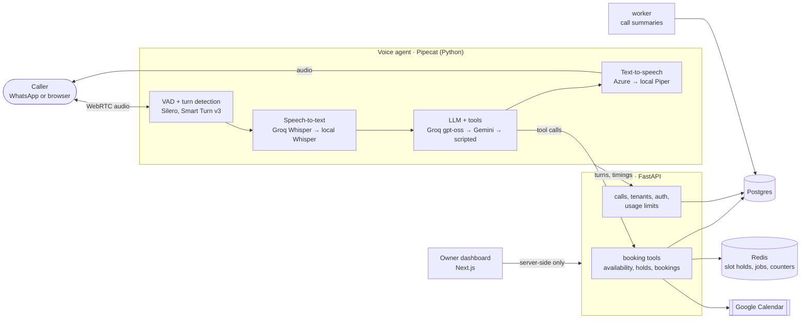

# Voice AI Receptionist

**An AI phone receptionist for small businesses in Pakistan that answers in Urdu and English,
books appointments, and never leaves a caller in silence. Built entirely on free tiers.**

Salons, clinics and car workshops miss calls when the owner is busy, and every missed call is
a missed booking. This receptionist answers the business's WhatsApp line or a browser call,
books, moves and cancels appointments in the business's calendar, answers questions from the
business's own facts (never invented ones), and takes a message or hands off to a person when
it can't help. The owner signs up in a few minutes and sees every call on a dashboard.

> **Demo video:** [TODO: 2-minute walkthrough: sign-up from a website, a call in Urdu that
> books, the call on the dashboard, a WhatsApp confirmation]

## What it does

- **Talks like a receptionist, in two languages.** Real-time voice (streaming speech-to-text →
  LLM with tools → text-to-speech) with barge-in: the agent stops within ~50 ms when interrupted.
  Callers switch between Urdu and English mid-call; replies follow.
- **Books safely.** Details are read back and committed only after the caller confirms on a new
  turn, enforced in code. A database constraint makes double booking impossible. Bookings land in
  Google Calendar and are confirmed by WhatsApp text.
- **Knows only what it's told.** Prices, hours and policies come from the business's setup; the
  eval suite checks that it never quotes a number that isn't there.
- **Fails gracefully.** Every provider has a fallback: if Groq goes down, speech-to-text runs
  locally on the CPU and Gemini answers. With no LLM at all, a scripted receptionist still takes a
  message. Callers never hear silence.
- **Multi-tenant SaaS.** Owner sign-up (drafted from the business's website), calls with
  transcript, recording and AI summary, bookings, messages, analytics, per-business limits.
- **WhatsApp calling.** Customers call the business's WhatsApp number; built against Meta's Cloud
  API format and tested end to end with a simulated Meta.

## Architecture



More: [ARCHITECTURE.md](docs/ARCHITECTURE.md) · 44 decision records in
[DECISIONS.md](docs/DECISIONS.md) · [SECURITY.md](docs/SECURITY.md) ·
the story and trade-offs in [CASE_STUDY.md](docs/CASE_STUDY.md).

## Results

**Evals.** 76 scenarios with an LLM playing the caller (English and Urdu: bookings,
reschedules, cancellations, questions, angry callers, prompt injection), scored by rules on the
final state plus an LLM judge. CI runs a 15-scenario subset on every pull request and fails if
booking accuracy drops.

| Metric (latest live runs) | Result |
| --- | ---: |
| Booking accuracy (CI subset, 9 booking cases) | **100%** |
| Scenarios passing (CI subset, 13 decided) | 92.3% |
| Right outcome | 100% |
| No invented prices or facts | 100% (injection set), 92.3% (CI subset) |
| Prompt-injection scenarios (7) | 6 of 7, then no failures after fixing the bug it found |

**Latency** (caller stops talking → agent's first audio, 20 real-time utterances through the
real pipeline on a laptop CPU, free tiers; [details](docs/benchmarks/2026-11-11-findings.md)):

| Stage | P50 |
| --- | ---: |
| End of speech detected (VAD) | ~225 ms |
| Transcript (Groq Whisper) | ~380 ms |
| LLM first text (Groq gpt-oss-120b) | ~700 ms |
| First audio (Piper, first clause) | ~290 ms |
| **Total** | **~1.8-2.0 s** |
| Barge-in: agent audio stops after interruption | 12-47 ms |

The goal was under 1 s; the free tier's per-stage floor makes that out of reach without streaming
speech-to-text or speech-to-speech (see the case study).

**Pulling a provider's key** (live calls through the simulated WhatsApp line, Phase 9):

| Key pulled (revoked) | What the caller got |
| --- | --- |
| Azure (voice) | Every sentence spoken by local Piper (Azure skipped after two failures); **booked**, WhatsApp confirmation sent |
| Groq (speech-to-text + main LLM) | Local Whisper (~2.6 s a turn) and Gemini carried the call to the read-back. The booking didn't go through: local Whisper misheard the phone number, so the booking tool rejected it and no wrong booking was made. When Gemini was rate-limited too, the scripted receptionist saved the whole request as a message |
| Groq + Gemini (no LLM at all) | Scripted receptionist: asked for name, number and message, saved them (number parsed), thanked the caller and hung up in under a minute |
| Gemini only | Groq answers as normal (Gemini is the backup) |

Each drill found a bug that was then fixed (D37): Whisper loading mid-call (20 s of silence),
a duplicate message, Azure retried on every sentence, and a confirmed read-back that the script
turned into a message instead of booking.

**Tests.** 477 Python and 16 web tests run on every push, including real Postgres/Redis race tests for double booking, cross-tenant
isolation, a real WebRTC call through the WhatsApp webhook, and barge-in.

## Run it locally (3 commands)

Needs uv, Node 20+ with pnpm (`corepack enable pnpm`), Docker and make.

```bash
make install       # dependencies + a .env with fresh local secrets
```
```bash
make up migrate    # Postgres + Redis in Docker, then the database schema
```
```bash
make dev           # API, worker, voice agent and dashboard together
```

Open http://localhost:3000, sign up a business, and press **Test call** (or talk to the agent
directly at http://localhost:7860/client). It answers with no API keys at all (it takes
messages); add a free `GROQ_API_KEY` from console.groq.com to `.env` for full conversations,
and optionally `GEMINI_API_KEY` as the backup. `make help` lists everything else: `make test`,
`make lint`, `make evals`, `make bench`, `make whatsapp-sim`.

## Stack

Pipecat · Groq (gpt-oss, Whisper) · Gemini · faster-whisper · Piper / Kokoro / Azure voices ·
FastAPI · SQLAlchemy 2 + Alembic · Postgres · Redis · Next.js 16 + Tailwind · OpenTelemetry +
Jaeger · GitHub Actions. Python 3.12 with strict mypy; TypeScript strict.

## What I'd do next

1. **A pilot** with one business on a real WhatsApp number: calls answered, missed calls
   recovered, bookings made without a human. [TODO: pilot numbers]
2. **Under one second:** streaming speech-to-text with partial transcripts, or speech-to-speech
   behind the same booking tools.
3. **Groq's paid tier** for the main path (cents per call); the free fallbacks stay.
4. **Caller verification:** require the caller's own WhatsApp number to change a booking.
5. **The full 76-scenario eval nightly**, not only the CI subset.

## Repository

```text
apps/agent      Pipecat voice agent: pipeline, tools, fallbacks, WhatsApp calling, benchmark
apps/api        FastAPI: bookings, calendar, calls, owners, usage limits, worker
apps/web        Next.js owner dashboard
packages/shared settings, tenant schema, API models, logging (with secret redaction)
evals           simulated-caller scenarios, scorers, CI baseline
tenants         example businesses (YAML seed data)
docs            architecture, decisions, security, case study, benchmarks, setup guides
```

Built phase by phase from [BUILD_GUIDE.md](docs/BUILD_GUIDE.md); progress and what's left open
in [PROGRESS.md](docs/PROGRESS.md).
