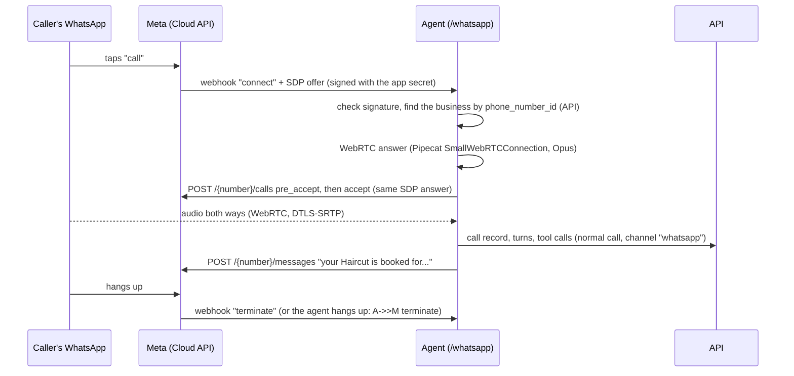

# WhatsApp calling

Customers call the business's WhatsApp number; the receptionist answers, books, and sends a
WhatsApp text confirming the booking. Calls that customers start are free on Meta's side.

There are two ways to run it:

1. **The simulator (no Meta account).** A local stand-in for Meta plus a scripted caller. This is
   what the tests and the demo use.
2. **Meta's real Cloud API**, with Meta's free test number or your own number.

The code is the same for both; only `.env` and the webhook URL change.

## How a call works



Code: `apps/agent/src/receptionist_agent/whatsapp/` (`webhook.py` signature check and parsing,
`calls.py` answering and running the call, `graph.py` Meta's API, `confirm.py` the confirmation
text, `routes.py` the `/whatsapp` endpoint, `fake_meta.py` the simulator). Decisions: D36.

## 1. Simulator demo (5 minutes, no accounts)

`.env` needs `WHATSAPP_ACCESS_TOKEN`, `WHATSAPP_APP_SECRET`, `WHATSAPP_VERIFY_TOKEN` and
`WHATSAPP_PHONE_NUMBER_ID`. Any values work with the simulator: random strings for the three
secrets (`openssl rand -hex 24`) and any digits for the number id (e.g. `100000000000002`).

1. Give a business that number: dashboard → **Settings → WhatsApp → WhatsApp phone number ID**,
   enter the same digits as `WHATSAPP_PHONE_NUMBER_ID`, and save.
2. Start the API, worker, and the agent pointed at the simulator:

   ```bash
   make api
   ```
   ```bash
   make worker
   ```
   ```bash
   WHATSAPP_GRAPH_URL=http://127.0.0.1:7870/v23.0 make agent
   ```
3. Call it:

   ```bash
   make whatsapp-sim ARGS='--say "I would like a haircut on Thursday at 4 pm." --say "Sara Ahmed, 0321 5550101." --say "Yes please." --say "No, goodbye."'
   ```

   Add `--language ur` for Urdu lines. The simulator prints how fast the call was answered, the
   Graph API calls the agent made (`pre_accept, accept, terminate`) and the WhatsApp message it
   sent, and saves what the caller heard to `data/whatsapp-sim/<call>.wav`. The call shows up on
   the dashboard with a WhatsApp badge.

A live run on 2026-11-12: answered in about 0.4 s, booked, confirmation sent, the agent hung up
after the goodbye. The automated version is `apps/agent/tests/test_whatsapp.py` (a real WebRTC
call, no network, no models).

## 2. Meta's real Cloud API (optional)

What you need: a Facebook account. Calling has to be enabled on the number (it's off by
default), and Meta's FAQ says the Calling API needs a payment method on the WhatsApp account even
though customer-started calls are free.

1. **App.** developers.facebook.com → My Apps → Create App → use case "Connect with customers
   through WhatsApp" → create or pick a Business portfolio.
2. **Test number.** In the app: WhatsApp → API Setup. Copy the **Phone number ID** into
   `WHATSAPP_PHONE_NUMBER_ID` (and into the business's Settings → WhatsApp). Under "To", add
   your own WhatsApp number and confirm the code.
3. **Token.** business.facebook.com → Settings → Users → System users → Add (Admin) → Assign
   assets (the app and the WhatsApp account, full control) → Generate token with
   `whatsapp_business_messaging` and `whatsapp_business_management` → `WHATSAPP_ACCESS_TOKEN`.
4. **Secrets.** App settings → Basic → App secret → `WHATSAPP_APP_SECRET`. Make up a long random
   `WHATSAPP_VERIFY_TOKEN`. Remove the `WHATSAPP_GRAPH_URL` override so the agent talks to
   graph.facebook.com.
5. **Payment method** (see above): Business settings → Billing & payments.
6. **Public URL for the webhook.** Meta must reach the agent over HTTPS:

   ```bash
   cloudflared tunnel --url http://127.0.0.1:7860
   ```

   In the app: WhatsApp → Configuration → Webhook → Callback URL
   `https://<tunnel>.trycloudflare.com/whatsapp`, Verify token = your `WHATSAPP_VERIFY_TOKEN`,
   → Verify and save. Then subscribe to the **calls** field.
7. **Enable calling** on the number:

   ```bash
   curl -X POST "https://graph.facebook.com/v23.0/$WHATSAPP_PHONE_NUMBER_ID/settings" \
     -H "Authorization: Bearer $WHATSAPP_ACCESS_TOKEN" -H "Content-Type: application/json" \
     -d '{"calling": {"status": "ENABLED"}}'
   ```
8. Call the test number from the WhatsApp **app** on your phone (WhatsApp Web can't place these
   calls).

Notes:
- A real business number (not the test number) needs Meta's 2,000-messages-a-day messaging
  limit before calling can be enabled.
- Pakistan: calls from customers work wherever the Cloud API works. Meta's calling availability
  page wouldn't load when this was written, so check it before relying on a Pakistani number.
- Audio: Meta uses ICE-lite and DTLS-SRTP and accepts only SHA-256 fingerprints in our answer
  (we strip the others). WebRTC media goes directly between Meta and the agent, so the agent's
  machine must allow outbound UDP.
